# maschine-fl

**Use a Native Instruments Maschine MK3 as FL Studio's own controller, with Maschine's way of working.**
FL Studio stays the DAW, with its channel rack, patterns, mixer, plug-ins and projects. The MK3 behaves
like Maschine on top of it, and its two screens are drawn in FL's look. NI's software doesn't run, and
nothing in FL needs to be mapped by hand.

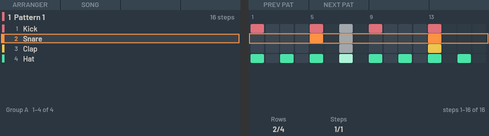

> **Experimental, vibe-coded software.** It was built by prompting an AI coding assistant
> ([Claude Code](https://claude.com/claude-code)) and testing the result on real hardware. One person has
> tried it, on one MK3, with FL Studio 26.1.5 on macOS 27. Expect rough edges and things that only work on
> that setup. It has no warranty, and it isn't affiliated with Native Instruments or Image-Line. Read
> [Status](#status) before you install it, and keep FL's autosave on.

## Platforms

| Platform                  | State                                                                                                                                   |
| ------------------------- | --------------------------------------------------------------------------------------------------------------------------------------- |
| **macOS** (Apple Silicon) | Works, on the author's machine                                                                                                          |
| **Windows**               | Port begun: the tests pass there, but it hasn't run with an MK3 or FL Studio yet and the screens have no route yet. See [docs/windows.md](docs/windows.md) |

Other controllers (MK2, Mikro, Studio), Intel Macs and other FL versions are untested.

## What it does

The buttons work as they do in Maschine, mapped to the nearest thing in FL Studio.

| On the MK3                       | In FL Studio                                                                                                                                                            |
| -------------------------------- | ----------------------------------------------------------------------------------------------------------------------------------------------------------------------- |
| **CHANNEL / PLUG-IN**            | The selected channel and its plug-in's parameters on the 8 knobs. NKS pages (names, sections, logo) for NKS-ready plug-ins, FL's own parameter list otherwise           |
| **MIXER**                        | FL's mixer in FL's look: tracks in their colour, volume, pan, meters, mute and solo per strip                                                                           |
| **ARRANGER**                     | The current pattern as channels and steps, with the play head                                                                                                           |
| **PATTERN** (hold)               | Pick, create, duplicate and double patterns, with the notes copied; length (16, 32, 64 …) and colour on the knobs                                                       |
| **STEP**                         | Step sequencer for the selected channel, 16 steps per page. Hold a step to edit its velocity and pitch                                                                  |
| **PAD MODE / KEYBOARD / CHORDS** | Play channels, a scale or chords (harmonizer and chord sets). KEYBOARD keeps its octave per channel. In PAD MODE a pad lights up while FL plays its channel              |
| **NOTE REPEAT**                  | Straight, dotted and triplet rates, LOCK, HOLD and GATE RESET. In KEYBOARD and CHORDS it can also arpeggiate (types, octaves, presets, rhythms, inversions, key range)  |
| **NAVIGATE** (VARIATION)         | Press to open: show or hide FL's Playlist, Piano roll, Channel rack, Mixer, Browser and plug-in window from the display buttons                                         |
| **GRID** (SHIFT + FOLLOW)        | FL's snap on the pads, and input quantize on display 2                                                                                                                  |
| **SELECT / MUTE / SOLO** (hold)  | Per channel, in banks of 16 picked with GROUP A–H                                                                                                                       |
| **BROWSER**                      | The selected plug-in's presets (scroll, highlight, load). **PLUG-INS** opens FL's plug-in picker to add an instrument as a new channel                                  |
| **SCENE**, **SHIFT + RESTART**   | Jump between playlist markers, set the song loop                                                                                                                        |
| **SHIFT + SCENE** (LIVE)         | FL's performance mode: a pad launches a scene at the track's trigger snap, and the screens show the tracks and the clip matrix with pattern names, bar and beat         |
| **VOLUME / SWING / TEMPO**       | Quick edit with the 4D encoder                                                                                                                                          |
| **SHIFT + pads**                 | Undo, redo, quantize, clear, copy, paste, octave and semitone                                                                                                           |
| **Touch strip**                  | Pitch bend, mod wheel, filter sweep, or play notes; play position when idle                                                                                             |
| **FILE / SETTINGS / FIXED VEL**  | Save, save a new version; pad velocity curve and screen brightness; fixed velocity                                                                                      |

Touching a knob twice resets it on the pages that have a default, and the page buttons also bring up the
matching FL window. Every control is in [docs/mapping.md](docs/mapping.md).

|                                                       |                                                                        |
| ----------------------------------------------------- | ---------------------------------------------------------------------- |
| 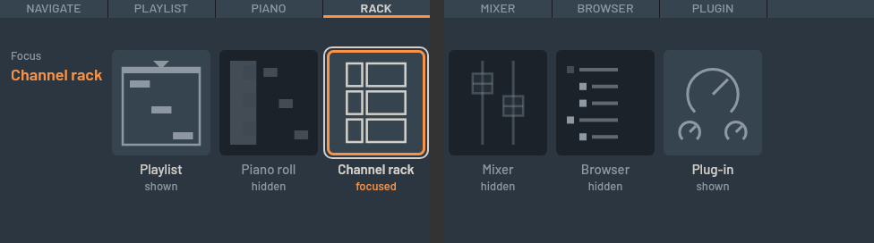                 | 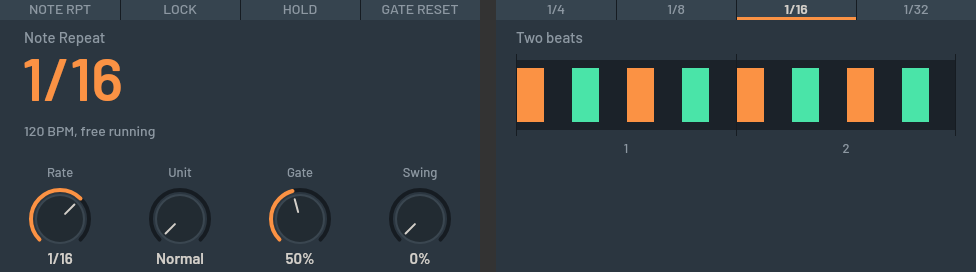                            |
| **NAVIGATE**: FL's windows on the display buttons     | **NOTE REPEAT**: rate, gate, swing and the rhythm it plays             |
| 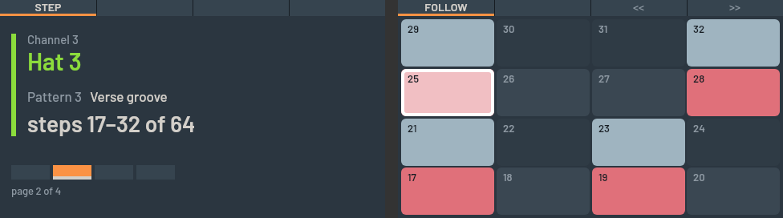 | 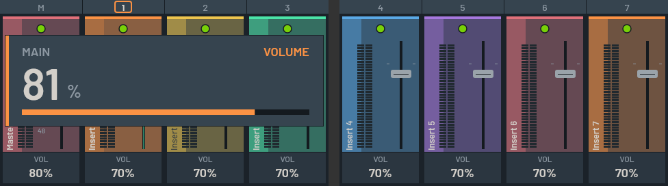 |
| **STEP**: 64-step pattern, page 2, play head          | **MIXER** with the VOLUME quick edit                                   |
| 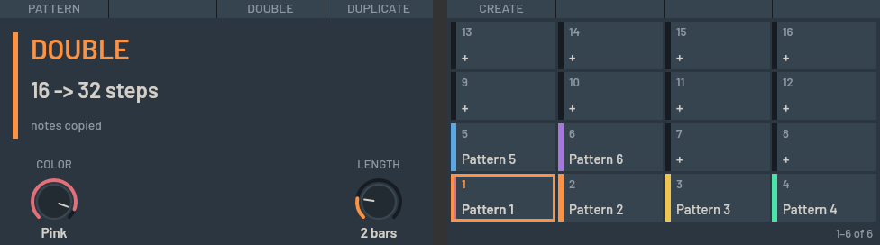       | 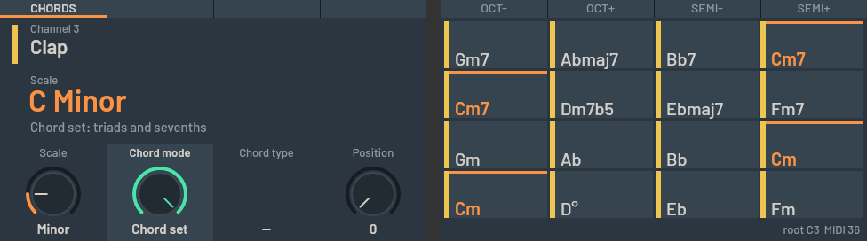                                  |
| **PATTERN**: DOUBLE, length knob, empty slots         | **CHORDS**: diatonic chord set in C minor                              |
| 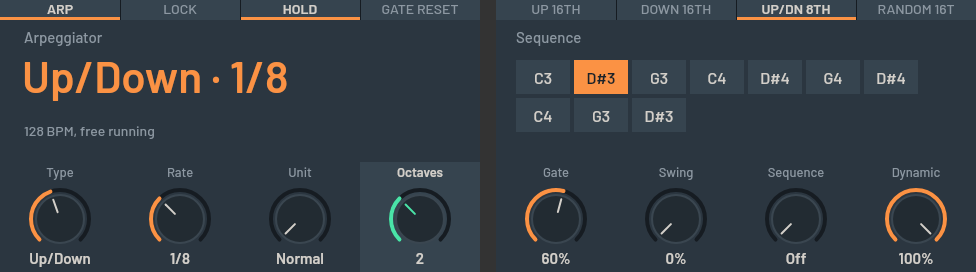            | 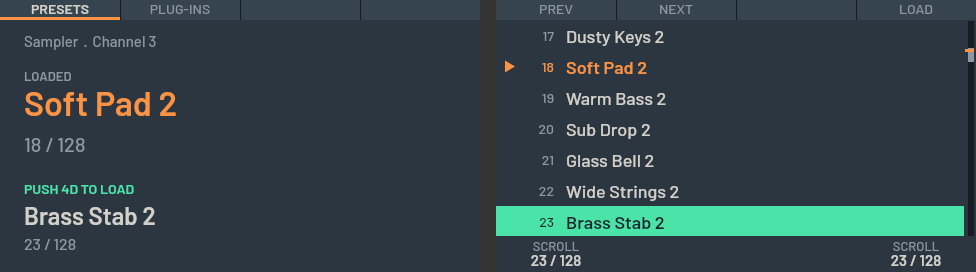                      |
| **ARP**: Up/Down over 2 octaves                       | **BROWSER**: highlight and loaded preset                               |
| 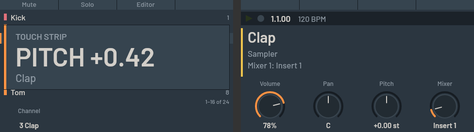  | 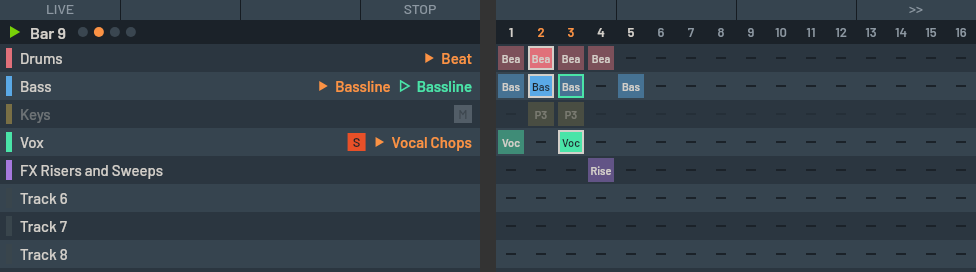                                          |
| **Touch strip** in PITCH mode                         | **LIVE**: performance-mode scenes, one playing and one queued          |

The images come from `npm run pagepng`, which renders every page from a demo project without the hardware.

## Status

Tried by the author on one MK3 with FL Studio 26.1.5 (macOS 27, Apple Silicon), unless it says otherwise.

**Works on the hardware**

- **Making patterns:** the page model, the pads in all three pad modes, STEP, recording from the pads,
  PATTERN (create, length, double, colour), SHIFT + pads, NOTE REPEAT, the arpeggiator and CHORDS.
- **Sound and mix:** CHANNEL and PLUG-IN knobs with NKS pages, MIXER with meters, BROWSER presets, adding an
  instrument through FL's plug-in picker, the touch strip in PITCH, MOD and NOTES, and screen brightness.
- **Song:** ARRANGER, SCENE, the song loop on and off (SHIFT + RESTART), FILE, and NAVIGATE, including a
  window behind another coming up on the first press.
- **Performance:** launching scenes in LIVE, STOP, paging through 16 columns at a time, and screens that show
  which track plays which pattern.

In short, you can make patterns and play a set from the MK3. Placing the clips of that set in the playlist
still takes the computer (see [Limits](#limits)).

**Built, not yet confirmed on the hardware**

- PLUG-IN's fix for parameters that jump on the first turn ([bug 6](docs/bugs.md)). FL can't report such a
  parameter's position until it has been set once, so its knob shows the value without a position until you
  first turn it, and while FL records, it doesn't move at all.
- KEYBOARD's octave per channel, and whether GRID's input quantize changes what you record as FL's manual says.
- NOTE REPEAT's LOCK and HOLD, holding a step to edit it, and touching a knob twice to reset it.
- The LOOP overlay (holding SHIFT + RESTART to move the loop's ends), and touch strip PERFORM picking the
  plug-in's cutoff by name.

**Known problems**

- **SHIFT + pads 13–16 (octave and semitone)** move the notes of a step-sequencer channel, but move notes
  recorded or drawn in the piano roll wrongly: one note per step, and chords can split. FL's script API can't
  select or move piano roll notes, so use FL's own transpose for those.
- **BROWSER on plug-ins with their own patch browser**, u-he Diva for example, steps FL's generic "Program n"
  list. Each step renames the channel and adds an undo step. It works as intended on plug-ins whose presets
  FL lists.
- **SCENE's marker positions** come from a scan that can be off after edits in FL until SCENE is opened again.
- **FL Studio froze once** with the script running (2026-10-21). macOS recorded no details and the cause is
  unknown.
- **The installer is untested on other machines.** The `mk3d` command, the login item and the Homebrew formula
  are tested without hardware only, and the formula has never run under Homebrew.

Bugs found on the hardware are numbered in [docs/bugs.md](docs/bugs.md).

## Getting started

You need:

- A Maschine MK3
- macOS (tested on macOS 27, Apple Silicon)
- FL Studio 2026 (tested with 26.1.5). Some features use functions added to FL's scripting API in 2026 and fall
  back on older versions
- Node.js 22 or newer (tested with 24), which Homebrew installs for you

With [Homebrew](https://brew.sh):

```bash
brew tap arpanet420/maschine-fl https://github.com/arpanet420/maschine-fl
brew install --HEAD maschine-fl
mk3d setup --service
```

Or from a clone:

```bash
git clone https://github.com/arpanet420/maschine-fl.git
cd maschine-fl
npm install
./bin/mk3d setup --service
```

`mk3d setup --service` links the FL script and starts mk3d at login. Then, in FL Studio under
Options → **MIDI Settings**:

1. Select the **MK3 Bridge** input, enable it, set its controller type to **MK3 Bridge** and give it a port number.
2. Give the **MK3 Bridge FB** output the same port number.

`mk3d doctor` checks the install. [docs/install.md](docs/install.md) covers upgrading, uninstalling and
troubleshooting, and [docs/setup.md](docs/setup.md) goes through FL's settings step by step.

**Going back to NI's software:** while mk3d has the MK3, NI's software can't use it. `mk3d stop --restore-ni` gives
it back, and `mk3d uninstall` removes everything mk3d installed. mk3d never edits or deletes NI's files.

## How it works

```
 Maschine MK3 ──USB/HID──▶ mk3d ──MIDI + SysEx──▶ FL Studio (MK3Bridge script)
   pads, knobs, 4D,       (Node)  "MK3 Bridge" / "MK3 Bridge FB"
   strip, buttons  ◀──screens and LEDs──┘
```

- **mk3d** is a small background daemon in Node and TypeScript. It takes over the MK3 over USB, reads the pads,
  buttons, knobs, 4D encoder and touch strip, and drives the two colour screens and every LED.
- **MK3Bridge** is a MIDI controller script for FL Studio, in Python. It sends FL's state (channels, mixer,
  patterns, plug-ins, transport) to mk3d and carries out what you do on the hardware.

Nothing on the MK3 is modified. mk3d sends LED and display reports, plus one feature report that sets the screen
brightness from SETTINGS. It never sends firmware commands.

## Limits

FL Studio's scripting API doesn't expose everything Maschine can do. Each of these was tried before it was
written down.

- **Building a performance set needs the computer.** No script call places, moves or deletes playlist clips, and
  recording in Song mode doesn't work once performance mode is on. Arrange the clips in FL's playlist, then play
  the set from the MK3.
- **The playlist is only readable in performance mode**, and only as filled, queued or playing blocks with a
  colour, without clip names. LIVE names a clip by the one pattern that has its colour, so give your patterns
  distinct colours. LIVE reads the first 8 tracks and launches whole scenes, not single clips.
- **Piano roll notes can't be read or edited**, so ARRANGER shows step-sequencer patterns and there is no
  Maschine-style EVENTS page.
- **Plug-ins can't be loaded from a script**, only through FL's picker, where mk3d can't show the names. You pick by
  looking at FL's screen.
- **NKS presets can't be loaded from the MK3.** The list a script can step is FL's, which for many plug-ins isn't
  the plug-in's own patch library ([docs/nks.md](docs/nks.md)).
- **A plug-in's parameter position can be unknown.** Some plug-ins, u-he Repro-5 for one, report no usable
  position to a script until the parameter has been set once.
- **No pattern delete, step undo, nudge or audio sampling:** FL has no script call for them. A sample editor is an
  idea, not built.

[docs/workflow.md](docs/workflow.md) lists what maps to FL and what doesn't.

## Documentation

Much of the work was finding out how things behave, and it is written down in case it helps someone else.

| Doc                             | What                                                                                     |
| ------------------------------- | ---------------------------------------------------------------------------------------- |
| [mapping.md](docs/mapping.md)   | Every control, page and overlay                                                          |
| [workflow.md](docs/workflow.md) | Maschine's workflow mapped to FL, and what has no equivalent                             |
| [install.md](docs/install.md)   | Installing, upgrading, uninstalling, troubleshooting                                     |
| [setup.md](docs/setup.md)       | FL Studio's settings, step by step                                                       |
| [windows.md](docs/windows.md)   | The Windows port: status, setup, timers, how the screens could work                      |
| [bugs.md](docs/bugs.md)         | Bugs found on the hardware, numbered, with their status                                  |
| [protocol.md](docs/protocol.md) | The MK3's USB and HID protocol, each fact marked verified or not                         |
| [sysex.md](docs/sysex.md)       | The SysEx protocol between mk3d and the FL script, with shared test vectors              |
| [nks.md](docs/nks.md)           | How NKS pages, preset names and logos are found in installed files (read-only)           |
| [fl-ilmcp.md](docs/fl-ilmcp.md) | FL Studio 2026's undocumented scripting functions: what exists and what works            |
| [design.md](docs/design.md)     | How FL draws its mixer and controls, and how the screens copy the look                   |

The protocol facts come from observing the author's own unit with the diagnostic tools in `src/tools/`, from reading
NI's installed agent for interoperability, and from the projects under [Acknowledgements](#acknowledgements). Treat
anything marked unverified as a guess.

## How this was made

Claude Code wrote the code, the tests and the documents from the author's prompts, specifications and hardware
test results, in small steps. The author tried each change on the MK3 and in FL Studio and reported what happened,
and the next change followed from that. [CLAUDE.md](CLAUDE.md) holds the rules the assistant works under, such as
which reports may go to the MK3, that tests never touch hardware and that the FL script must catch every exception.
[PLAN.md](PLAN.md) is the plan and the hardware test log.

About 1,300 tests in TypeScript and 400 in Python check the logic without hardware, but only real use shows whether
it feels right. Read the code before you trust it with a project you care about, and keep FL's own backups on.

## Contributing

Reports from other setups are the most useful thing right now: which MK3 firmware, which macOS and FL versions, what
worked and what didn't. The daemon's log (`mk3d logs`) shows what FL and the MK3 said. It contains your MK3's serial
number, so remove that before you paste it anywhere.

Pull requests are welcome, small ones first. Run `npm run check` before you send one.

## Development

```bash
npm run check      # prettier, typecheck, lint, the vitest tests and the FL script's tests (no hardware)
npm run mk3d       # run the daemon from source
npm run pagepng    # render every page to out/*.png from a demo project
npm run build      # compile to dist/ for the installed daemon
```

| Path                   | What                                                                 |
| ---------------------- | -------------------------------------------------------------------- |
| `src/hw/`              | USB and HID input, LEDs and the two displays                         |
| `src/modes/`           | The page model and every page                                        |
| `src/fl/`              | The SysEx protocol and FL's state on the mk3d side                   |
| `src/nks/`             | Matching FL's plug-ins to NKS presets and their knob pages           |
| `src/platform.ts`      | What differs between macOS and Windows                               |
| `src/tools/`           | Diagnostic tools: enumerate, input log, LED and display tests        |
| `fl-script/MK3Bridge/` | The FL Studio MIDI script                                            |
| `bin/mk3d`, `Formula/` | The installed command and the Homebrew formula                       |
| `scripts/`             | NI's agents, linking the FL script, copying to a Windows machine     |

## Acknowledgements

This would have taken far longer without other people's open work. Thank you to:

- [**asutherland/ni-controllers-lib**](https://github.com/asutherland/ni-controllers-lib) (ISC), a Node
  library for NI controllers with Maschine MK3 support and a fork of
  [met5678/node-traktor-f1](https://github.com/met5678/node-traktor-f1): the starting map of the MK3's HID
  reports (buttons, knobs, LEDs, display format), which mk3d then re-checked and corrected on a real
  device.
- [**shaduzlabs/cabl**](https://github.com/shaduzlabs/cabl) (MIT), by Vincenzo Pacella: the
  origin of the Maschine LED colour palette.
- [**terminar/rebellion**](https://github.com/terminar/rebellion) (LGPL-3.0), by Björn Kalkbrenner:
  a different way to drive NI hardware (through NI's own agents), which showed what is possible and
  why mk3d talks to the USB device itself.
- [**Aftalyfe/MaschineMK3FLStudioScript**](https://github.com/Aftalyfe/MaschineMK3FLStudioScript):
  an earlier FL Studio script for the MK3, read for how FL scripts and Controller Editor mappings fit
  together.
- [**IL-Group/FL-Studio-API-Stubs**](https://github.com/IL-Group/FL-Studio-API-Stubs) (LGPL-3.0), by
  Image-Line: the documentation of FL Studio's MIDI scripting API that the FL script was checked against.
- [**Panic-Signals/Deckard**](https://github.com/Panic-Signals/Deckard) (GPL-2.0), an open-source Maschine clone with
  its own MK3 driver: the first place to look when unsure how Maschine behaves, and the source of three hardware
  facts, among them the screen brightness report.
- [**RufusIbiza/Encdr**](https://github.com/RufusIbiza/Encdr) (GPL-3.0), a Rust library for NI controllers, which draws
  the MK3's screens through NI's own service on Windows: the likely route for this project's Windows port.

No code from these projects is in this repository; the palette table from cabl and the facts taken from others are
credited in [THIRD_PARTY_NOTICES.md](THIRD_PARTY_NOTICES.md). Thanks also to the
authors of [node-hid](https://github.com/node-hid/node-hid), [node-usb](https://github.com/node-usb/node-usb),
[@julusian/midi](https://github.com/Julusian/node-midi) and
[@napi-rs/canvas](https://github.com/Brooooooklyn/canvas), which mk3d is built on.

## Disclaimer

An independent hobby project, not affiliated with or endorsed by Native Instruments, Image-Line
or u-he. Maschine and NKS are trademarks of Native Instruments; FL Studio is a trademark of
Image-Line; Diva is a product of u-he and is only the plugin the author tested NKS pages with.
This repository contains no files from any of them: fonts, plugin artwork and NKS data are read
from your own installed software at runtime. Use it at your own risk; the author is not
responsible for lost work or for anything that happens to your hardware or projects. The parts
that come from other projects are credited in [THIRD_PARTY_NOTICES.md](THIRD_PARTY_NOTICES.md).
