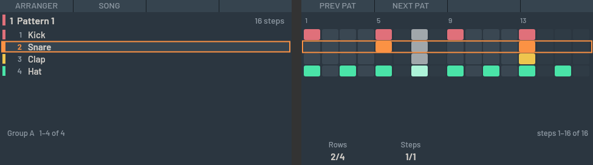
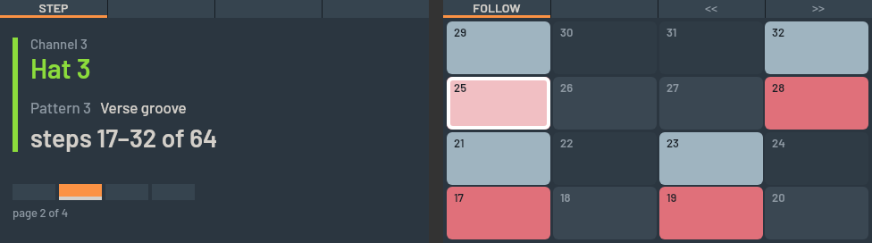
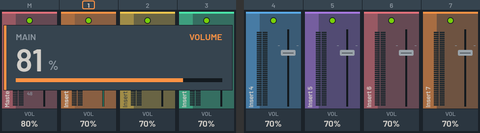
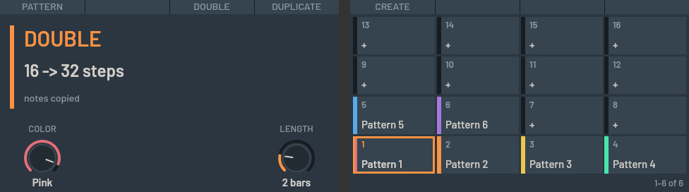
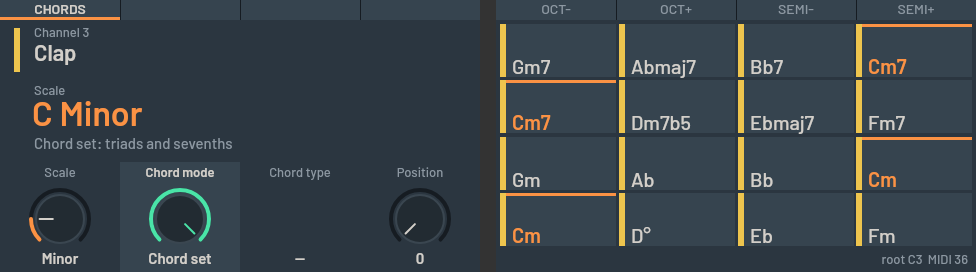
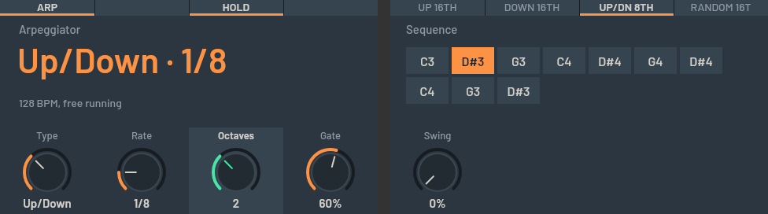
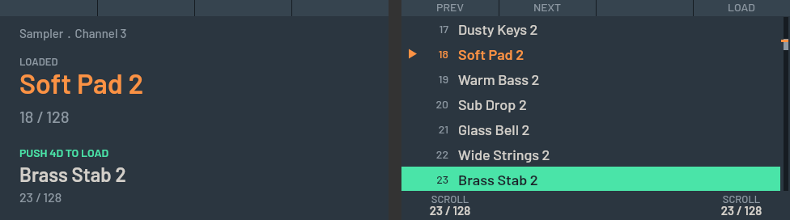
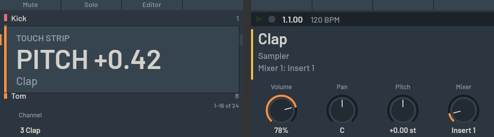
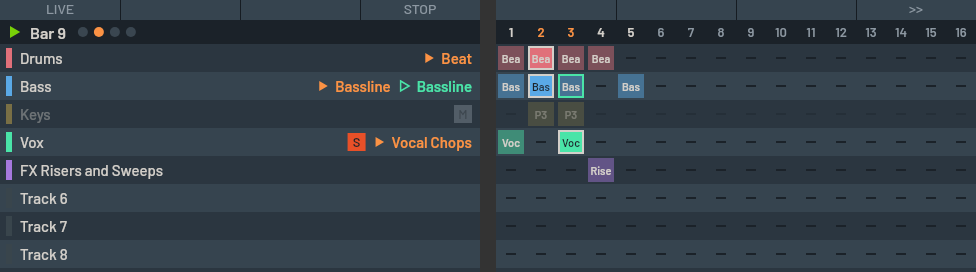

# maschine-fl

Control **FL Studio directly with the Maschine workflow**: a **Native Instruments Maschine MK3** that
works as FL Studio's own hardware controller on macOS, with Maschine's way of working on the pads,
knobs and buttons and FL Studio's look on the two screens.

## The goal

Maschine is a great way to make music, and FL Studio is where many people already have their
projects, plugins and habits. Normally you pick one: the MK3 drives NI's Maschine software or
Komplete Kontrol, or you map it to FL as a plain MIDI box and lose the workflow. This project aims at
the third option: **FL Studio stays the DAW** (its channel rack, patterns, mixer, plugins and
projects), and **the MK3 behaves like Maschine** on top of it: hold PATTERN to pick and double
patterns, play the pads as a keyboard, chords or arpeggios, turn the eight knobs on the plugin's own
parameters (NKS pages), step-sequence on the pads, browse presets, see FL's mixer and meters on the
screens, and launch the scenes of FL's performance mode from the pads. No NI software runs, and
nothing in FL needs to be mapped by hand.

> **Experimental, vibe-coded software.** This project was built by prompting an AI coding
> assistant ([Claude Code](https://claude.com/claude-code)) and testing the result on real hardware.
> One person has tried it, on one MK3, with FL Studio 26.1.5 on macOS 27. Expect rough edges and
> things that only work on that setup. It is not reviewed by a team, it has no warranty, and it is
> not affiliated with Native Instruments or Image-Line. Please read [Status](#status) before you
> install it, and tell us what breaks. See [How this was made](#how-this-was-made).



The MK3 normally only works properly with NI's own software. This project replaces that layer:

- **mk3d**, a small macOS background daemon (Node + TypeScript), takes over the MK3 over USB. It
  reads the pads, buttons, knobs, 4D encoder and touch strip, and drives the two colour screens
  and every LED.
- **MK3Bridge**, a MIDI controller script for FL Studio (Python), talks to mk3d over virtual MIDI
  ports and SysEx. It sends FL's state (channels, mixer, patterns, plugins, transport) to the MK3
  and carries out what you do on the hardware.

```
 Maschine MK3 ──USB/HID──▶ mk3d ──virtual MIDI + SysEx──▶ FL Studio (MK3Bridge script)
   pads, knobs, 4D,        (Node)  "MK3 Bridge" / "MK3 Bridge FB"
   strip, buttons  ◀──screens and LEDs──┘
```

While mk3d has the device, NI's own software cannot use it. Nothing on the MK3 is modified: mk3d
only sends the standard LED and display reports (`0x80` / `0x81`), never firmware or feature
reports.

## What it does

The buttons work the way they do in Maschine, mapped to the nearest FL Studio concept:

| On the MK3                       | In FL Studio                                                                                                                                                                    |
| -------------------------------- | ------------------------------------------------------------------------------------------------------------------------------------------------------------------------------- |
| **CHANNEL / PLUG-IN**            | The selected channel and its plugin's parameters on the 8 knobs; NKS pages (names, sections, logo) for NKS-ready plugins such as u-he Diva, FL's own parameter list otherwise   |
| **MIXER**                        | FL's mixer in FL's look: tracks tinted with their colour, volume, pan, meters, mute/solo per strip                                                                              |
| **ARRANGER**                     | The current pattern as channels × steps, with the play head                                                                                                                     |
| **PATTERN** (hold)               | Pick, **create** (a pad that is empty), duplicate and **double** patterns (the notes are copied); pattern length (16, 32, 64 …) and colour on the knobs                         |
| **STEP**                         | Step sequencer for the selected channel, 16 steps per page                                                                                                                      |
| **PAD MODE / KEYBOARD / CHORDS** | Play channels, a scale, or chords (harmonizer and chord sets); in PAD MODE a channel's pad lights up while FL plays it                                                          |
| **NOTE REPEAT**                  | Note repeat in PAD MODE, an arpeggiator (modes, octaves, rate) in KEYBOARD and CHORDS                                                                                           |
| **SELECT / MUTE / SOLO** (hold)  | Per channel, in banks of 16 picked with GROUP A–H                                                                                                                               |
| **BROWSER**                      | The selected plugin's presets (scroll, highlight, load); **PLUG-INS** opens FL's plugin picker to add an instrument as a new channel                                            |
| **SCENE**, **SHIFT + RESTART**   | Jump between playlist markers, set the song loop                                                                                                                                |
| **SHIFT + SCENE** (LIVE)         | FL's performance mode: a pad launches a scene (a column of clips) at the track's trigger snap; the screens show the tracks and the clip matrix with pattern names, bar and beat |
| **VOLUME / SWING / TEMPO**       | Quick edit with the 4D encoder                                                                                                                                                  |
| **SHIFT + pads**                 | Undo, redo, quantize, clear, copy, paste, octave and semitone                                                                                                                   |
| **Touch strip**                  | Pitch bend, mod wheel, filter sweep, or play notes; play position when idle                                                                                                     |
| **FILE / SETTINGS / FIXED VEL**  | Save, save a new version; pad velocity curve; fixed velocity                                                                                                                    |

Page buttons also bring up the matching FL window (mixer, playlist, channel rack, piano roll).

|                                                       |                                                                        |
| ----------------------------------------------------- | ---------------------------------------------------------------------- |
|  |  |
| **STEP**: 64-step pattern, page 2, play head          | **MIXER** with the VOLUME quick edit                                   |
|        |                                   |
| **PATTERN**: DOUBLE, length knob, empty slots         | **CHORDS**: diatonic chord set in C minor                              |
|             |                       |
| **ARP**: Up/Down over 2 octaves                       | **BROWSER**: highlight vs loaded preset                                |
|   |                                           |
| **Touch strip** in PITCH mode                         | **LIVE**: performance-mode scenes, one playing and one queued          |

The screen images come from `npm run pagepng`, which renders every page from a demo project
without the hardware. The full control list is in [docs/mapping.md](docs/mapping.md).

## Status

Everything below was tried by the author on one MK3 and FL Studio 26.1.5 (macOS 27, Apple
Silicon) unless it says otherwise.

**Works well (tried on hardware):**

- **Making patterns:** the page model and every page button listed above; pads in all three pad
  modes, with PAD MODE's pads lighting up while the sequencer plays their channel; STEP; recording
  from the pads; PATTERN (create, length, double, colour); SHIFT + pads (undo, redo, quantize,
  clear, copy, paste); NOTE REPEAT and the arpeggiator; CHORDS.
- **Sound and mix:** CHANNEL / PLUG-IN knobs with NKS pages; the MIXER with meters; BROWSER
  presets; adding an instrument through FL's plugin picker; the touch strip in PITCH, MOD and
  NOTES modes.
- **Song:** ARRANGER (pattern overview), SCENE (jumps between playlist markers), the song loop
  on and off (SHIFT + RESTART), FILE (save).
- **Performance (LIVE):** launching scenes in FL's performance mode (every track with a clip in
  that column starts, the others stop, at each track's trigger snap), STOP, paging through 16
  columns at a time, and screens that show which track plays which pattern without looking at
  the computer.

In short: everything up to and including playing a set works from the MK3. Putting the clips of
a set into the playlist does not (see [Limits](#limits)).

**Known problems and not yet tried:**

- **SHIFT + pads 13–16 (octave and semitone) move the notes of a step-sequencer channel, but
  notes recorded or drawn in the piano roll are moved wrongly** (one note per step, chords can
  split). FL's script API cannot select or move piano roll notes. Use FL's own transpose for those.
- **BROWSER on plugins with their own patch browser** (u-he Diva, for example) steps FL's generic
  "Program n" list, not the plugin's patches: each step renames the channel and adds an undo step.
  It works as intended on plugins whose presets FL lists.
- **SCENE's marker positions** come from a scan that can be off after edits in FL until SCENE is
  opened again. The LOOP overlay (holding SHIFT + RESTART to move the loop's ends) is not
  confirmed on hardware yet.
- **Touch strip PERFORM** (filter sweep) finds the plugin's cutoff parameter by name; the fix for
  picking the wrong parameter is not yet confirmed on hardware.
- **FL windows following the page buttons** works, but it is not certain it is useful; it may
  change.
- **FL Studio froze once** during a session with the script running (2026-10-21); macOS recorded no
  details and the cause is unknown. Keep FL's autosave on.
- **The installer is untested on other machines**: the `mk3d` command, the login item
  (LaunchAgent) and the Homebrew formula are written and tested without hardware only, and the
  formula has never run under Homebrew. See [docs/install.md](docs/install.md).
- **Other hardware and versions** (Maschine MK2, Mikro, Studio, Intel Macs, other FL versions,
  Windows) are untested; there is no Windows support at all.
- A **sample editor** is an idea, not built.

## Requirements

- macOS (tested on macOS 27 on Apple Silicon)
- Maschine MK3
- FL Studio 2026 (tested with 26.1.5). Some features use functions added to FL's scripting API in
  2026, and fall back gracefully on older versions.
- Node.js 22 or newer (tested with 24), installed by Homebrew if you use it; Python 3 for the FL script's tests

## Getting started

With [Homebrew](https://brew.sh):

```bash
brew tap arpanet420/maschine-fl https://github.com/arpanet420/maschine-fl
brew install --HEAD maschine-fl
mk3d setup --service   # link the FL script, start mk3d at login
```

Then, in FL Studio under Options → **MIDI Settings**, enable the **MK3 Bridge** input with
controller type **MK3 Bridge**, and give the **MK3 Bridge FB** output the same port number.
`mk3d doctor` checks the install. See [docs/install.md](docs/install.md) (upgrading, uninstalling,
troubleshooting) and [docs/setup.md](docs/setup.md) (FL's settings step by step).

From a clone, without Homebrew:

```bash
git clone https://github.com/arpanet420/maschine-fl.git
cd maschine-fl
npm install
./bin/mk3d setup --service
```

`mk3d stop --restore-ni` gives the MK3 back to NI's software, and `mk3d uninstall` removes
everything it installed. mk3d never deletes or edits NI's files.

## Limits

FL Studio's scripting API does not expose everything Maschine can do. These are the walls we
hit, each tried before it was written down:

- **Building a performance set needs the computer.** No script call places, moves or deletes
  playlist clips. FL's own way of placing a clip without the mouse, recording in Song mode, does
  not work once performance mode is on (the song position can't be set to a column, and nothing is
  recorded). Arrange the clips in FL's playlist, then play the set from the MK3.
- **The playlist is only readable in performance mode**, and then only as filled / queued /
  playing blocks with a colour: no clip names. LIVE names a clip by the one pattern that has its
  colour, so give your patterns distinct colours (PATTERN, knob 1). LIVE reads the first 8 tracks
  and launches whole scenes, not single clips (yet).
- **Piano roll notes can't be read or edited**, so ARRANGER shows step-sequencer patterns and
  there is no Maschine-style EVENTS page.
- **Plugins can't be loaded from a script**, only through FL's plugin picker (BROWSER, PLUG-INS);
  mk3d can't show the names there, you pick by looking at FL's screen.
- **NKS presets can't be loaded from the MK3.** The preset list a script can step is FL's, which
  for many plugins is not the plugin's own patch library ([docs/nks.md](docs/nks.md)).
- **No pattern delete, step undo, nudge or audio sampling**: FL has no script call for them.

[docs/workflow.md](docs/workflow.md) lists what maps and what doesn't.

## Research notes

Much of the work was finding out how things behave, and the findings are written down in
[docs](docs/) in case they help someone else:

| Doc                             | What                                                                                                               |
| ------------------------------- | ------------------------------------------------------------------------------------------------------------------ |
| [protocol.md](docs/protocol.md) | The MK3's USB / HID protocol: input reports, pads, screens, LEDs, each fact marked verified or not                 |
| [sysex.md](docs/sysex.md)       | The SysEx protocol between mk3d and the FL script, with shared test vectors                                        |
| [nks.md](docs/nks.md)           | How NKS plugin pages, preset names and logos are found in NI's installed files (read-only)                         |
| [fl-ilmcp.md](docs/fl-ilmcp.md) | FL Studio 2026's undocumented scripting functions: what exists, what works from a controller script, what does not |
| [design.md](docs/design.md)     | How FL draws its mixer and controls, and how the screens copy the look                                             |
| [workflow.md](docs/workflow.md) | Maschine's workflow mapped to FL, and what has no equivalent                                                       |
| [mapping.md](docs/mapping.md)   | Every control, page and overlay                                                                                    |

The protocol facts come from observing the author's own unit with small diagnostic tools in
`src/tools/` and from reading NI's installed agent for interoperability. Treat anything marked
unverified as a guess.

## How this was made

The code, the tests and the documents were written by Claude Code from the author's prompts,
specifications and hardware test results, in small steps: the author tried each change on the
MK3 and in FL Studio and reported what happened, and the next change followed from that.
[CLAUDE.md](CLAUDE.md) holds the rules the assistant works under (for example, nothing is ever
sent to the MK3 except LED and display reports, tests never touch hardware, and the FL script
must catch every exception) and [PLAN.md](PLAN.md) is the plan and hardware test log. The automated tests (about 1,200 in TypeScript, 390 in Python) check the logic
without hardware, but only the author's own use shows whether it feels right, so read the code
before you trust it with a project you care about, and keep FL's own backups on.

## Contributing

Reports from other setups are the most useful thing right now: which MK3 firmware, which macOS
and FL versions, what worked, what did not. The daemon's log (`mk3d logs`) shows what FL and the
MK3 said; it contains your MK3's serial number, so remove that before you paste it anywhere.
Pull requests are welcome, small ones first. Run `npm run typecheck`, `npm run lint`,
`npm test` and `npm run test:fl` before you send one.

## Development

```bash
npm run typecheck   # tsc
npm run lint        # eslint
npm test            # vitest, no hardware needed
npm run test:fl     # the FL script's Python tests
npm run build       # compile to dist/ for the installed daemon
npm run pagepng     # render every page to out/*.png
```

| Path                   | What                                                                                                                                                                                                                         |
| ---------------------- | ---------------------------------------------------------------------------------------------------------------------------------------------------------------------------------------------------------------------------- |
| `bin/mk3d`             | The installed command: setup, service, doctor, logs                                                                                                                                                                          |
| `Formula/`             | The Homebrew formula                                                                                                                                                                                                         |
| `src/hw/`              | USB/HID input, LEDs and the two displays                                                                                                                                                                                     |
| `src/modes/`           | The page model and every page (Maschine's page stack: home, main pages, hold-to-peek overlays, tool pages)                                                                                                                   |
| `src/fl/`              | The SysEx protocol and FL's state on the mk3d side                                                                                                                                                                           |
| `src/nks/`             | NKS lookup: matching FL plugins to NKS presets and their knob pages                                                                                                                                                          |
| `fl-script/MK3Bridge/` | The FL Studio MIDI script                                                                                                                                                                                                    |
| `docs/`                | Protocol notes ([USB](docs/protocol.md), [SysEx](docs/sysex.md)), the [control mapping](docs/mapping.md), the [workflow design](docs/workflow.md) and notes on FL's undocumented functions ([fl-ilmcp.md](docs/fl-ilmcp.md)) |

## Acknowledgements

This would have taken far longer without other people's open work. Thank you to:

- [**asutherland/ni-controllers-lib**](https://github.com/asutherland/ni-controllers-lib) (ISC), a Node
  library for NI controllers with Maschine MK3 support and a fork of
  [met5678/node-traktor-f1](https://github.com/met5678/node-traktor-f1): the starting map of the MK3's HID
  reports (buttons, knobs, LEDs, display format), which mk3d then re-checked and corrected on a real
  device.
- [**shaduzlabs/cabl**](https://github.com/shaduzlabs/cabl) (MIT), by Vincenzo Pacella: the
  origin of the Maschine LED colour palette.
- [**terminar/rebellion**](https://github.com/terminar/rebellion) (LGPL-3.0), by Björn Kalkbrenner:
  a different way to drive NI hardware (through NI's own agents), which showed what is possible and
  why mk3d talks to the USB device itself.
- [**Aftalyfe/MaschineMK3FLStudioScript**](https://github.com/Aftalyfe/MaschineMK3FLStudioScript):
  an earlier FL Studio script for the MK3, read for how FL scripts and Controller Editor mappings fit
  together.
- [**IL-Group/FL-Studio-API-Stubs**](https://github.com/IL-Group/FL-Studio-API-Stubs) (LGPL-3.0), by
  Image-Line: the documentation of FL Studio's MIDI scripting API that the FL script was checked against.

Nothing from these projects is copied into this repository (the palette table, from cabl, is
credited with its licence in [THIRD_PARTY_NOTICES.md](THIRD_PARTY_NOTICES.md)). Thanks also to the
authors of [node-hid](https://github.com/node-hid/node-hid), [node-usb](https://github.com/node-usb/node-usb),
[@julusian/midi](https://github.com/Julusian/node-midi) and
[@napi-rs/canvas](https://github.com/Brooooooklyn/canvas), which mk3d is built on.

## Disclaimer

An independent hobby project, not affiliated with or endorsed by Native Instruments, Image-Line
or u-he. Maschine and NKS are trademarks of Native Instruments; FL Studio is a trademark of
Image-Line; Diva is a product of u-he and is only the plugin the author tested NKS pages with.
This repository contains no files from any of them: fonts, plugin artwork and NKS data are read
from your own installed software at runtime. Use it at your own risk; the author is not
responsible for lost work or for anything that happens to your hardware or projects. The parts
that come from other projects are credited in [THIRD_PARTY_NOTICES.md](THIRD_PARTY_NOTICES.md).
